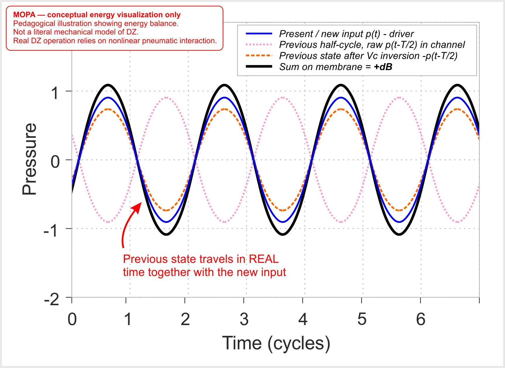
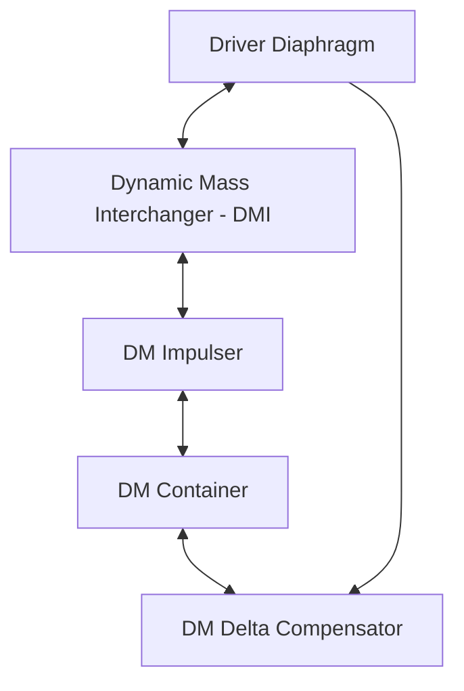

# Dynamic Zero (DZ)

> **Experimental Modular Acoustic Architecture & Dynamic Air Mass Control**

---

# Dynamic Zero --- Design Principle vs. Mechanism Interpretation

> **Important context**
>
> Dynamic Zero is an experimental, measurement-driven architecture. The
> physical behaviour of the system is observed first; the interpretation
> of the mechanisms is refined as new measurements and comparisons
> become available. Descriptions in this project should therefore not be
> read as a claim that every aspect of the operating mechanism was
> predicted in advance or is already fully understood.

------------------------------------------------------------------------

## Design Principle vs. Mechanism Interpretation

The core design principle of Dynamic Zero has remained unchanged since
the earliest prototypes: to control the interaction between the
diaphragm and the moving air mass, rather than intentionally relying on
resonance as the primary operating mechanism.

While the design objective has remained constant, the complete behaviour
of the system was not predicted in advance. Several characteristics
emerged only after physical prototypes were constructed, measured and
compared against reference enclosures.

As a result, the design direction remains unchanged, while the
interpretation of the underlying mechanisms continues to evolve as new
measurements and observations become available.

**Dynamic Zero should therefore be viewed as a measurement-driven
architecture rather than a theory-driven architecture.**

In other words, the observed behaviour is not modified to fit the
theory. The theory is continuously refined to explain the observed
behaviour.

---

## Executive Overview

**Dynamic Zero (DZ)** is an experimental acoustic array architecture designed to govern system phase, acoustic loading, and force distribution in real time through a dynamic, state-dependent pneumatic network.

Rather than treating the cabinet as a static passive box, DZ couples the transducer diaphragm to a state-dependent pneumatic network consisting of four core functional nodes: the **Dynamic Mass Interchanger (DMI)**, **DM Impulser**, **DM Container**, and **DM Delta Compensator**.

The architecture is grounded in a single physical observation: in a conventional driver, the rear diaphragm surface generates an equal and opposite pressure wave that is discarded. DZ treats this rear-wave energy as recoverable pneumatic work rather than waste.

The original architectural objective was not to create a secondary acoustic radiator. The objective was to recover pneumatic energy and air-mass momentum that would normally be dissipated and return it to the active system state.

In practice, other DZ elements may also contribute measurable acoustic output. Such output is currently regarded as a consequence of system operation rather than the primary design objective.


---

## Core Theoretical Framework & Physical Mechanics

| Traditional Acoustics | Dynamic Zero (DZ) | Consequence |
|---|---|---|
| Static resting point (0 V reference) | Dual dynamic reference points (+0 / −0) | Symmetrical energy distribution across both half-cycles |
| Fixed enclosure-dependent acoustic loading | State-dependent pneumatic loading | Effective pneumatic load changes with system state |
| Linear, time-invariant system | State-dependent, nonlinear system with memory | Adapts to instantaneous signal state in real time |
| Thiele–Small (T/S) compatible | Not fully represented by conventional T/S enclosure modelling | Requires new measurement and characterisation approach |

In essence, DZ treats the loudspeaker as a state-dependent pneumatic system rather than a purely reactive one, using the rear-wave energy as an active part of the acoustic process.

---

### 1. Balanced Excursion Architecture (+0 / −0 Reference Points)

Traditional driver topologies operate around a single static mechanical resting point — analogous to a single-ended amplifier operating between 0 V and +12 V. Under high excursion, this leads to asymmetric loading and energy dissipation.

**Dynamic Zero operates as a fully balanced (bridge-mode) mechanical-pneumatic architecture:**

- **Dual Dynamic Reference Points (+0 and −0):** The system operates around two dynamic phase-equilibrium points (+0 and −0), representing the instantaneous velocity turnover bounds of each half-cycle.
- **Full-Bridge Analogy:** Similar to a balanced audio amplifier splitting swing symmetrically (+6 V / −6 V), DZ treats both half-cycles as fully symmetric active operating regimes.
- **State-Continuous Pneumatic Mechanism:** The pneumatic network maintains physical continuity between successive half-cycles. The new input therefore interacts with the pneumatic state inherited from the previous motion.

---

### 2. Theoretical System States & Dynamic Targets

To model and evaluate the nonlinear behaviour of the DZ architecture, two governing physical concepts define the target dynamic state of the internal network.

#### Reciprocal Pneumatic Symmetry (RPS)

The architectural ideal state of a DZ module in which pneumatic energy across both half-cycles becomes functionally equivalent, independent of signal amplitude or frequency. In this state, the DM Impulser and compensator network minimise asymmetry and preserve continuity of energy exchange.

RPS represents the theoretical design target of the DZ architecture. Practical implementations approach but do not guarantee this state, due to driver tolerances, chamber geometry variations, and diaphragm imperfections.

#### Inter-Cycle Momentum Continuity (ICMC)

The retention of fluid (air mass) momentum state between successive half-cycles within the DZ pneumatic network. Each half-cycle output is constructed upon the momentum state established during the previous half-cycle.

ICMC is a physical property of the coupled chamber network — not an artificial storage mechanism, but a direct consequence of air mass inertia persisting across cycle boundaries.

> **Extended state model:** The distributed physical memory hypothesis, including momentum heritage, mismatch-dependent attenuation, and second-order erasure heritage, is developed separately in [state-space and memory model notes](./architecture.md).

---

### MOPA Analogy & Non-Resonant Operation

A useful conceptual analogy for the DZ energy interaction is a **Master Oscillator Power Amplifier (MOPA)**. DZ is not an acoustic implementation of an optical MOPA; the comparison refers only to the dynamic interaction between inherited and newly generated energy states.

The diagram below illustrates the idealised interaction between the inherited pneumatic state and the new driver-generated state:



In an idealised periodic T/2 case:

\[
p(t-T/2)=-p(t)
\]

After pneumatic inversion:

\[
p(t)+[-p(t-T/2)]=2p(t)
\]

This represents an ideal pressure ratio of 2:1, corresponding to approximately +6 dB. This theoretical value cannot be achieved in a real DZ system due to unavoidable losses.

---

### Resonance Is Not the Operating Principle

Dynamic Zero is **not a resonance-based loudspeaker architecture**.

Resonant modes inevitably exist in any real mechanical and pneumatic system, just as they exist in any real engine. Their presence does not mean that the system operates by resonance.

In DZ, resonance is not used as a tuning mechanism. Internal resonant modes are treated as **parasitic conditions** to be minimized.

- **Bass-reflex / resonant systems:** resonance is part of the operating mechanism.
- **Dynamic Zero:** resonance is a parasite, not the mechanism.

---

### 3. The Dynamic Mass & Resonance Tracking Hypothesis (Fd < Fin)

Conventional Thiele–Small (T/S) theory relies on a fixed free-air driver resonance (Fs), below which diaphragm displacement becomes unconstrained and highly distorted.

DZ introduces the concept of **Dynamic Resonance (Fd)**:

- **Fluid Momentum Coupling:** The internal chambers act as an adaptive pneumatic governor. As signal velocity changes, flow inertia through the DM Impulser dynamically alters the effective air mass coupling.
- **Frequency Tracking (Fd < Fin):** As the incoming signal frequency (Fin) drops, the active moving air mass automatically increases, keeping the system's dynamic resonance Fd continuously below the signal frequency.
- **Controlled Displacement:** Because Fin constantly remains above Fd, the diaphragm operates in a continuously loaded acoustic regime across all frequencies — eliminating uncontrolled sub-resonant excursion.

> **Note:** Conventional T/S enclosure modelling does not fully characterise DZ behaviour. T/S assumes a linear, time-invariant system with fixed parameters. DZ is a state-dependent, nonlinear system with distributed momentum memory.

---

### Why T/S Modelling Does Not Fully Apply to DZ

The fundamental difference is one of design priority: conventional T/S enclosure modelling is resonance-centred, while DZ is pneumatic-process-centred.

T/S driver parameters (Fs, Vas, Qts, Re, etc.) remain valid for characterising the driver itself. However, conventional T/S enclosure simulation assumes a passive acoustic load. Because DZ actively modifies the working fluid state around the diaphragm, the system cannot be reduced to a simple passive resonance model.

T/S modelling characterises the driver/enclosure system primarily through small-signal parameters, acoustic compliance, moving mass, damping and resonant behaviour. DZ does not deny these effects, nor does it ignore them. Instead, the architecture is designed primarily around the pneumatic state and controlled mass exchange surrounding the radiator. Resonant and wave effects remain present, but they are not the primary mechanism.

Therefore, reducing DZ to chamber volumes and equivalent port lengths can produce a conventional resonant model of the geometry, but it does not necessarily describe the pneumatic behaviour that the design is built around.

DZ also introduces system variables that are not represented directly in the conventional T/S parameter set: the effective front-to-rear interaction area ratio, rear-side restrictions, and state-dependent mass interchange dynamics.

---

### 4. Theoretical Low-Frequency Extension Towards 0 Hz

The Dynamic Zero principle itself does not impose a theoretical lower-frequency boundary. Under idealised conditions, the operating frequency may asymptotically approach 0 Hz.

Practical implementations are limited by two distinct constraint layers:

- **Driver constraints:** volumetric air displacement (ΔV), mechanical suspension compliance, and motor linearity.
- **DZ architecture constraints:** chamber geometry, internal damping, and construction tolerances — all of which affect how precisely the pneumatic network can maintain the intended state continuity.

This theoretical limit highlights the core promise of DZ: low-frequency reproduction is no longer fundamentally limited by the driver's mechanical resonance in a fixed box, but by the engineering precision and physical constraints of the system.

---

## Internal Cycle Mechanics Around Turnover Points

Within an individual module, energy interchange operates as a continuous, momentum-driven fluid pendulum:



1. **Pneumatic Exchange (DMI):** The Dynamic Mass Interchanger forms the primary exchange interface between the driver diaphragm and the internal DZ pneumatic network, transferring air-mass momentum into and out of the working fluid.

2. **Inertial Transfer (DM Impulser):** The DM Impulser governs the acceleration and transfer of moving air mass between the DMI and the DM Container.

3. **Pneumatic State Continuity (DM Container):** The Container forms part of the pneumatic volume in which pressure distribution and air-mass momentum from preceding motion remain physically present.

4. **State Difference Compensation (DM Delta Compensator):** The Compensator provides controlled bidirectional mass exchange when the inherited pneumatic state and the new system input produce a state mismatch.

> *This represents the working theoretical hypothesis under ideal DZ conditions. Practical chamber volume ratios and geometric tolerances are continuously refined through empirical prototyping.*

---

## Scalable Array Topology

Dynamic Zero modules can be combined into larger arrays.

During early experiments, an interaction between individual DZ modules was observed when multiple modules were connected **in series**. The combined system did not behave simply as a collection of independent modules.

This effect is currently experimental and has not yet been systematically characterised.

---

## Key Experimental Observations

- **Subharmonic Generation:** Strong, coherent subharmonic tracking observed under specific drive conditions. Subharmonics track proportionally as input frequency changes — structured, not chaotic.
- **Compensator Time Constant:** Closing the DM Delta Compensator eliminates DZ effects immediately. Re-opening requires approximately 4–5 seconds for the system to re-establish its pneumatic energy state.

---

## Primary Research Objectives

1. Formalize the mathematical state-space model for state-dependent dynamic air mass coupling.
2. Empirical measurement of phase response and impedance shifts across scaling steps.
3. Open-source release of 3D-printable CAD models, slice profiles, and measurement sets for independent verification.

---

## Relation to Acoustic Suspension

DZ was developed independently of Villchur's work, but can be understood as its extension. Villchur used enclosed air as a spring. DZ uses enclosed air as a working fluid in a regenerative pneumatic system.

**Acoustic suspension: air as spring.**

**Dynamic Zero: air as working fluid.**

The historical path is independent, but the physical idea is continuous: **from spring to engine.**

---

## Repository Structure

```
├── README.md
├── docs/
│   ├── theory.md          # Fd tracking & mathematical state-space formulation
│   ├── architecture.md    # Internal chamber mechanics (DMI, Impulser, Container, Compensator)
│   └── measurements.md    # Empirical FR, SPL, and impedance measurement sets
├── cad/                   # 3D-printable STL/STEP files for DZ Modules
├── hardware/              # Assembly topology & coupling hardware specifications
└── images/                # Array topology diagrams, SPL plots, schema
```
---
*Delta Signum — deltasignum.org*
